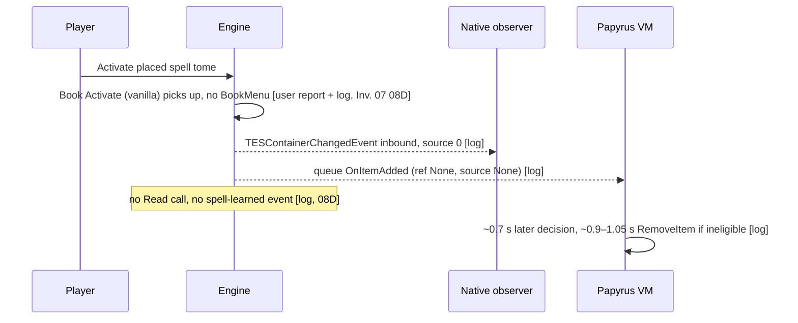
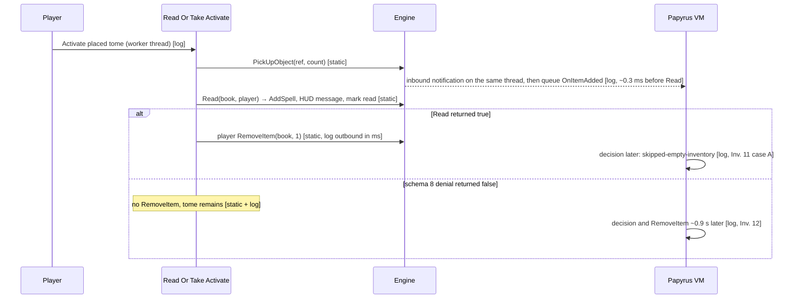

# Investigation 13 — Spell-tome lifecycle and authoritative eligibility

## Purpose and evidence levels

This investigation asks where the engine teaches a spell from a tome, where it moves the tome, and when Papyrus learns of either. The answer decides which component must own eligibility. No code, ESP, build or deployment was changed. The schema 8 baseline (Investigation 12) is untouched.

The evidence levels used below are:

- **Static (disassembly):** read from the local Skyrim `1.7.104.0` `SkyrimSE.exe` with `dumpbin /disasm`. Callees and globals were mapped to Address Library IDs through the local format-5 `versionlib-1-7-104-0.bin`. IDs were named only where the AE column of a CommonLib `RELOCATION_ID` matches.
- **Runtime (log):** preserved native and Papyrus logs from Investigations 07–12.
- **User report:** an outcome the user observed in game, with no independent log.
- **Hypothesis:** inferred, not verified.

## v1.0 gameplay contract (decided in Task 05B)

| Decision | Consequence for the architecture |
| --- | --- |
| Acquisition **and** spell learning are both protected | A tome must not teach before its acquisition is decided. A read with no acquisition at all, such as a container-side read, is undecided. |
| The existing Papyrus eligibility rules remain authoritative | Native code never evaluates eligibility. It only knows whether a decision is pending (option C). |
| Merchant and safe-location exemptions are preserved | They stay in Papyrus unchanged, including the current approximations (open BarterMenu; town, inn and store locations). |
| Previously accepted inventory tomes can be read normally | A player-side read with nothing pending forwards. No per-copy history is kept. |
| Retrieving a stored tome is a new acquisition | Current behaviour. The ledger treats it like any inbound addition. |
| Read Or Take is optional | Every mechanism keys on `TESObjectBOOK::Read` and the inbound notification, which exist without Read Or Take. |
| Containers and corpses are supported where technically feasible | Container and corpse Takes go through Papyrus as today. Container-side reads are handled as undecided reads (section 13). |
| Physical world-reference preservation is deferred beyond v1.0 | A denied Read Or Take world READ may leave the tome in the inventory, where Papyrus decides. Leaving the tome in the world is out of scope. |
| Carrier hazards, defensive enchantments and Dispel Magic are future features | Not designed here. |
| Already-known spells do not bypass acquisition restrictions | Current behaviour. Papyrus ignores whether the spell is known. A gated read of a known spell would also have been a no-op read. |

This answers questions 1, 2, 4 (two-step learning is acceptable for v1.0; deferred automatic reading is not added), 5 and part of 3 in section 12. The remaining open questions are listed there.

## 1. Engine findings

### `TESObjectBOOK::Read` (AE 17842, RVA `280290`)

Static. Arguments are book in `rcx` and reader in `rdx`.

1. If the reader is null or differs from the global at AE 401069, `Read` returns false without acting. The global is not named in CommonLib; that it is the player reference is a hypothesis. Read Or Take passes the activating actor, and the observed reads used the player.
2. If book flag bit 1 (skill book) is set, the skill branch runs.
3. If flag bit 4 (teaches spell) is set and the spell at `book+0x118` is non-null, `Read` calls **`Actor::AddSpell`** (AE 38716) on the `PlayerCharacter` singleton (AE 403521), at `2803B4`. The result goes in `sil`. It then formats **"New Spell Learned"** or **"You already know"** with the spell name.
4. If the book is not yet marked read, `Read` sets flag 8 and adds a change flag. This happens whatever `AddSpell` returned.
5. It shows the message through `SendHUDMessage::ShowHUDMessage` (AE 52933). The **`UISpellLearned`** sound is used only when `sil` is set.
6. It returns `sil`, meaning the spell was newly added.

`Read` never removes the book. **Learning happens inside `Read`. Consumption is the caller's decision, based on the return value.** DEST's documented patch region (`+0x11D` to `+0x173`, Inv. 05) is exactly step 3. That explains why DEST and Heart of Magic suppress learning there and zero `rsi` to prevent consumption.

### Read callers in the executable

Static. These are the three known direct `call` sites from Inv. 07. Indirect callers would not appear in that byte scan.

| Site | Enclosing function | Book source | Use of the return value |
| --- | --- | --- | --- |
| `9074F8` | `907290` = **`BookMenu::OpenMenu_Impl`** (AE 51053) | `BookMenu::GetTargetForm()` (AE 405835) | **Ignored.** Opening the book menu teaches or levels, and the caller consumes nothing. |
| `91382E` | `9136A0` (AE 51149, unnamed) | The selected container item | If true: invoke `isViewingContainer` on the menu movie (AE 82256 `GFxValue` invoke, string `isViewingContainer`). If viewing the container, resolve `ContainerMenu::GetTargetRefHandle` (AE 405962) and call that reference's `RemoveItem` vfunc (`+0x2B0`) with count 1. Otherwise call the player's `RemoveItem`. The same function calls `BookMenu::OpenMenu_Impl` for other books. |
| `945D97` | `945BF0` (AE 51870, unnamed) | The selected inventory item | If true: the player's `RemoveItem` (`+0x2B0`, count 1), then `ItemList::Update_Impl` (AE 51031). |

The runtime logs attribute site `945D97` to InventoryMenu (Inv. 08, 11, 12). Site `91382E` is attributed to ContainerMenu by its `isViewingContainer` and `ContainerMenu` target-handle use (static).

### Read Or Take 1.5.1

Static, from Inv. 12 and the published source. It replaces only `TESObjectBOOK` vfuncs `0x37` (`Activate`) and `0x4C` (activate text).

- **READ** of a spell tome: `PickUpObject`, then `Read(actor)`, then, if true, `actor->RemoveItem(book, 1)`.
- **TAKE:** `PickUpObject` only.
- Spell tomes use READ only when `bAutoUseSpellTomes=true`, which is the default. With `kAuto`, a book already marked read is taken.
- Inventory and container reads are untouched.

## 2. Lifecycle sequences

Evidence for each step is marked in brackets.

### Vanilla world activation, without Read Or Take



### Read Or Take world READ



### Inventory READ (vanilla, and unchanged by Read Or Take)

```mermaid
sequenceDiagram
    participant P as Player
    participant M as InventoryMenu (945BF0)
    participant E as Engine
    P->>M: Use tome (main thread) [log]
    M->>E: Read(book, player) → AddSpell [static, log known 0→1]
    alt newly learned (true)
        M->>E: player RemoveItem(book, 1), ItemList update [static, log outbound]
    else already known (false)
        Note over M: "You already know", tome kept, marked read [static, earlier log Inv. 08]
    end
    Note over P,E: no OnItemAdded; Papyrus does not participate
```

### Container and corpse

- **Take** from a container or corpse is expected to be a single transfer: an inbound notification with a non-zero old container, and `OnItemAdded` with `akSourceContainer` set. There is no `Read` call. This is a hypothesis: no isolated container or corpse Take of a tome is preserved in the logs (Inv. 06 checklist still pending).
- **Read from the container side:** site `91382E` calls `Read` and, on success, removes the tome from the container reference (static). **The spell is taught with no addition to the player's inventory and no `OnItemAdded`.** Papyrus can never see it. A corpse or pickpocket ContainerMenu view presumably uses the same path (hypothesis). This vanilla bypass is verified statically but has not been run.
- **Read from the player side** of a ContainerMenu removes from the player on success (static).

### Script or console acquisition

The console `player.additem` produced an inbound notification with source 0 on the main thread (log, Inv. 12 session 4). `OnItemAdded` with `ref None` is expected and was logged in earlier spawned-tome trials. No `Read` call occurs until the player reads the tome.

## 3. Acquisition and reading decision matrix

Current behaviour, with Untamed Tomes enabled and the player below the threshold in a dangerous location:

| Interaction | Teaching boundary | Papyrus sees it | Current outcome | With schema 8 denial |
| --- | --- | --- | --- | --- |
| Vanilla world activate | None | Yes, after the fact | Removed, never learned | Same |
| Read Or Take world TAKE | None | Yes | Removed | Same |
| Read Or Take world READ | `Read` from the Read Or Take DLL, synchronous | Yes, after learning | **Learned, Papyrus finds nothing** | Denied, then removed |
| Container or corpse Take | None (hypothesis) | Yes | Removed | Same |
| **Container-side READ** | `Read` at `91382E`, main thread (hypothesis) | **No** | **Learned, removed from container** | Forwarded, so still learned (`game_executable_caller`) |
| Inventory READ of an accepted tome | `Read` at `945D97` | No | Learned, consumed | Forwarded |
| Inventory READ within ~0.9 s of an ineligible addition | `Read` at `945D97` | Decision still pending | Learned, then Papyrus removes or finds nothing (race) | Forwarded, so the race remains |
| Read of an already-known spell | `AddSpell` false | Not for the read | "You already know", tome kept | Same, unless the Read Or Take world path denies first |
| Script or console add | None | Yes | Removed if ineligible | Same |
| BookMenu read of a spell tome (`9074F8`) | `Read`, return ignored | Depends | Learned without consumption | Forwarded. When vanilla reaches this for a spell tome is unknown. |
| Barter merchant-side read | Unknown: no BarterMenu caller identified | Unknown | Untested | Untested |

The engine has one teaching boundary, `Read`, which calls `AddSpell`. It is shared by inventory, ContainerMenu, BookMenu, Read Or Take, and any SKSE plugin calling `Read`. There are many acquisition paths, but on none of them does acquisition itself teach.

## 4. Gameplay contract and open design points

Established by the README, overview, Inv. 02 and the current Papyrus code:

- Wild tomes can reject a character lacking magical ability. The current measure is base Magicka against the threshold. The competence model of Inv. 02 is logged but not yet used.
- Merchant purchases are intended to be safe. Today this is approximated by "BarterMenu open", plus town, inn and store locations being safe.
- `UT_TomeSafe`, `UT_TomeExclusions` and reference quest items are exempt.
- Rejection is evaluated **at acquisition**, using the context at Papyrus handler time. A rejected copy is removed.
- **No rule exists for reading.** A tome that reaches and stays in the inventory has implicitly been accepted, or predates the mod. Reading it is never checked.
- Backlash is planned and not implemented.

Undecided points, listed in section 10, are not resolved here.

## 5. Policy ownership

| | A. Native policy snapshot | B. Per-acquisition coordinator | C. Temporary read guard (pending ledger) | D. Native eligibility engine |
| --- | --- | --- | --- | --- |
| Idea | Papyrus publishes inputs; native evaluates `Read` synchronously | Native tracks each acquisition from intent to completion and owns removal | Native blocks teaching of a tome base form while its Papyrus acquisition decision is pending; Papyrus stays the only policy | Policy moves to C++; Papyrus does presentation and backlash |
| Complexity | Medium: publishing, staleness and context inputs | High: hooks at every acquisition path, identity, crime and stack semantics (Inv. 10) | Low to medium: one ledger, one Papyrus acknowledgement call | High: rewrite policy and MCM coupling, plus location and keyword logic natively |
| Determinism | Depends on snapshot freshness (02B: input-driven snapshots were tens of seconds stale) | High where hooks exist | High: an entry is added synchronously in the inbound notification, which precedes `Read` on the same thread on the Read Or Take path (log) | High |
| Policy duplication | Partial: the context rules remain | Full | **None**: native never evaluates eligibility | Full move |
| Save state | None | Interaction records; invalidate on load | Transient; cleared on load | None beyond settings |
| Main failure mode | Stale or partial inputs give wrong allow or deny | Partial coverage silently loses protection; destination veto loses items | A stuck entry (lost acknowledgement, VM stall) blocks reading that base form until timeout | Divergence from the Papyrus behaviour and MCM; large regression surface |
| Fits current architecture | Partly | No (replaces it) | **Yes** | No |

**Assessment.** Teaching has one engine boundary, and the current contract decides eligibility at acquisition. Native code therefore does not need to know the policy. It needs to know only whether the relevant acquisition has been decided. That is option C, plus a rule for reads that have no acquisition at all: the Read Or Take world READ before its pickup is decided, and the container-side READ. For those, the only Papyrus-consistent answer without moving policy native is **"not decided, do not teach yet"**. That is what schema 8 does for the Read Or Take path. A and D are needed only if the design requires instant, synchronous direct learning for eligible characters (section 7). B solves per-copy problems the current contract does not have (section 6).

### Synchronisation for C

- **Add.** When a player-inbound change for a teaching book is notified, native code increments `pending[baseForm]`. The notification is synchronous and carries the base form and count (log, Inv. 12). This uses the same population that Papyrus filters on: the `VendorItemSpellTome` keyword.
- **Acknowledge.** Papyrus calls one new native function at **every** exit of the tome branch of `OnItemAdded`: disabled, non-tome, safe, excluded, quest, eligible, and after `RemoveItem`. It passes the base form and count. Native code then decrements the entry.
- **Gate.** In the existing `Read` entry detour, an inventory-side read of a base form with `pending > 0` returns false (denied, not consumed). Every other inventory read forwards. Non-inventory reads with no acquisition (the Read Or Take world path before acknowledgement, and the container side) are denied as "undecided".
- **Expiry.** Clear the ledger on load. Expire an entry after a bounded time, for example 10 s, with a logged warning. Expiry fails open, which is today's behaviour, so a VM stall degrades to the existing race rather than to a permanent block.

## 6. Item identity

Is per-copy identity required? **Not under the current contract.**

- The only state that matters is "this base form has an undecided acquisition". A count per base form models it exactly. The inbound notification, the Papyrus event and `RemoveItem` all already work per base form and count (Inv. 01, 10).
- **Multiple copies.** While a new copy is pending, reads of an older accepted copy of the same base form are also blocked, for up to about 1 s. This is a harmless false denial. Per-copy identity would avoid it, but at the cost of the stack and extra-data identity problems of Inv. 10.
- **One copy removed, another kept.** Papyrus removal by base form can already take an older copy (Inv. 01). This is unchanged by C and is a separate existing issue.
- **Concurrent pickup and read.** On the Read Or Take path the inbound notification precedes `Read` on the same thread, so the ledger entry exists before the read (log). For two quick acquisitions the counter is 2, and two acknowledgements clear it. In Inv. 12, reads 2 and 3 arrived 0.68 s apart on different worker threads, so the ledger needs atomic updates.
- **About 0.9 s Papyrus delay.** This is exactly the window C closes for inventory reads.
- **Save/load while pending.** Papyrus may still run a queued event after load. Clearing the ledger on load reopens the race for that one event. Persisting the ledger is not justified.
- **Script or VM stalls.** Expiry with fail-open, as above.
- **Transfers between player and containers.** Putting a tome into a chest is outbound and changes nothing. Taking it back is a new acquisition, re-evaluated by Papyrus as today. That a stored accepted tome is re-judged on retrieval is current behaviour, and is listed as a design question.

Per-copy identity becomes necessary only if the design wants protection to stay attached to a specific physical tome, for example "bought here, safe forever wherever it goes".

## 7. Direct world reading for eligible characters

With schema 8, a Read Or Take world READ always becomes a Take. There are three ways to let an eligible character learn directly:

1. **Synchronous native policy** (A or D). This is instant, but it duplicates or moves the policy. The location inputs would be read on Read Or Take's worker thread (log), the hazard identified in 02B.
2. **Deferred read completion.** Deny now. After Papyrus accepts the tome, Papyrus asks native code to complete the read on the main thread: call `Read(book, player)` and, if true, remove one copy, mirroring Read Or Take. This keeps Papyrus as the single owner. The player learns about 1 s later, and native code adds a Papyrus-callable function. It handles only the Read Or Take path, because a container-side read has no acquisition to accept.
3. **Leave the two-step behaviour.** Take now, then read from the inventory. This is the simplest option, but it changes Read Or Take's advertised behaviour.

Option 2 is the only one that keeps a single policy owner and still delivers direct learning. It depends on C's acknowledgement, so it would be the second prototype, not the first.

## 8. Compatibility

- **Vanilla, without Read Or Take.** World activation never teaches. The remaining gaps are the inventory race and the container-side read, and a read gate on `Read` covers both. Read Or Take must not become a dependency. Every gate keys on the `Read` boundary, which exists without it.
- **Read Or Take 1.5.1.** Its default `bAutoUseSpellTomes=true` contradicts acquisition-time rejection unless reads are gated. Users can set it to `false` for pure vanilla-compatible behaviour, where every spell tome becomes a Take. Supporting the default needs schema 8-style identification, or option 7.2.
- **Other read mods.** DEST, Lodestone and Heart of Magic patch or detour `Read` itself and are refused (Inv. 08). Auto-Reading-style plugins call `Read` directly. They would be classified as inventory reads only when the classifier evidence says so. Otherwise they count as undecided under C.
- **Runtimes.** Everything above is 1.7.104. The 1.6.1170 executable needs the same static checks (`Read` body, AddSpell call, caller sites) before any port.

## 9. Risks

| Risk | Severity | Likelihood | Mitigation |
| --- | --- | --- | --- |
| Container-side read teaches with no Papyrus involvement | High (bypass) | Medium (player must choose Read in the container view) | Treat as undecided and deny, then verify at runtime first |
| Lost Papyrus acknowledgement blocks reading | Medium | Low to medium (new call at every exit, VM stalls) | Expiry with fail-open, logging, and a single exit helper in Papyrus |
| Ledger population differs from Papyrus' keyword gate | Medium | Medium | Use the same keyword. A tome without the keyword never gets an entry, which is current behaviour. |
| Unidentified `Read` callers (indirect, Barter) | Medium | Unknown | Keep `unknown` as forward-and-log during prototyping, then add a call-site census |
| Base-form counting blocks an accepted duplicate for about 1 s | Low | Low | Accept, and document |
| Schema 8 name dependency on Read Or Take | Low | Low | Replace with "a read not on the inventory-side path while the form is undecided" once C exists |
| Already-known tomes: a denied read gives no "You already know" message | Low | Medium | Design question 5 |

## 10. Recommendation

Adopt **C: a native teaching gate with Papyrus as the single eligibility owner, synchronised by a base-form pending ledger.** Treat any read with no decided acquisition as undecided. Keep Papyrus policy, MCM and removal unchanged apart from one acknowledgement call. Do not adopt A, B or D now:

- A and D are needed only if instant direct learning becomes a design requirement.
- B is needed only if protection must follow individual physical copies.

Schema 8's Read Or Take denial is a correct special case of "undecided", not the permanent identification mechanism.

## 11. Smallest useful prototype

The first prototype is **observation-only ledger validation** and blocks nothing:

1. **Native.** Maintain `pending[base]` from player-inbound teaching-book notifications. Register one Papyrus native, for example `UntamedTomesNative.AcknowledgeTomeAddition(Form base, Int count)`. In the `Read` detour, log `would_gate=1|0` with the ledger state, classifier context and age of the oldest entry. Forward every read.
2. **Papyrus.** Call the acknowledgement at every exit of the tome branch of `OnItemAdded`.
3. **Runtime matrix:**
   - vanilla world activate;
   - Read Or Take world READ;
   - inventory read within 1 s of an ineligible pickup;
   - inventory read of an accepted tome;
   - two copies of one base form;
   - Take All with several tomes;
   - a container-side read in a dungeon chest, to confirm `91382E` and the missing `OnItemAdded`;
   - save and load while an entry is pending;
   - Untamed Tomes disabled;
   - a safe town pickup.
4. **Success criteria:** every entry is acknowledged, with no expiries in normal play. `would_gate=1` occurs exactly for the racing and undecided reads. Acknowledgement latency matches the existing 0.6–1.0 s decision times.

Only after that should the gate deny. Deferred read completion (section 7, option 2) comes afterwards, if the design wants it.

## 12. Questions requiring a gameplay-design decision

1. ~~Acquisition, learning, or both?~~ **Decided: both.** An accepted inventory tome stays readable.
2. ~~Is acceptance permanent?~~ **Decided:** acceptance holds while the tome is carried. Retrieving a stored tome is a new acquisition.
3. Container-side reading. **Decided for v1.0:** supported where feasible, as an undecided read. *Open:* is reading in a container acceptable in a safe location (town chest, merchant-owned container), or must the tome always be taken first?
4. ~~Read Or Take one-step READ for eligible characters?~~ **Decided:** Read Or Take is optional. The two-step result (Take, then read from the inventory) is acceptable for v1.0, and deferred automatic reading is not added.
5. ~~Already-known spells?~~ **Decided:** they do not bypass acquisition restrictions.
6. Are corpses and owned or stolen tomes judged by location alone, as now, or by provenance?
7. Do console and script additions follow the rules (today: yes)?
8. Should untagged spell-teaching books, which lack the keyword, be protected?
9. Can merchant stock be read in BarterMenu without buying? Should it be?
10. Is the player told when reading is blocked, and how? This includes the denied "You already know" case.
11. Should the ledger fail open (current prototype) or fail closed when an acknowledgement is missing? See section 14.

## 13. Observation-only ledger prototype (Task 05B)

### Implementation

Native checkout, schema 9. No read is blocked or altered.

| File | Change |
| --- | --- |
| `src/TomeLedger.h` | New. A thread-safe ledger of pending additions per base FormID: a FIFO of additions with capture times and counts. `Add`, `Acknowledge` (statuses `matched`, `count_mismatch`, `excess`, `late`, `unmatched`), `Peek`, `Expire` (10 s TTL; expired units are kept briefly to classify late acknowledgements) and `Clear`. `EvaluateLedgerGate(pending, context)` is the observation-only gate rule. |
| `src/main.cpp` | New marker `UntamedTomes.ObserveLedger`, mutually exclusive with the others, mode `observe_ledger`. The entry detour is installed with the existing guards, forwards every read, and also logs classifier rows. The container sink calls `ledger_add` for player-inbound additions whose base form is a BOOK with Skyrim.esm `VendorItemSpellTome` (`000937A5`). The deployed ESP binds exactly that keyword to `MagicTomeKeyword`, which was checked against the plugin. Other rows: the `ledger_ack` native, a `tome_read_ledger` row per player spell-tome read, `ledger_expired`, `ledger_cleared` on every load or new game, and `ledger_ready` with the keyword resolution. `schema=9`. The schema 8 denial mode is unchanged and still separately selectable. |
| `tests/tome_ledger.cpp` | New. Single acquisition, two copies in FIFO order, stack split and merge, excess, repeated and invalid acknowledgements, expiry and late credit, clear on load, concurrent producers and acknowledgers (2 × 2000), and the gate rule. |

Papyrus, `Scripts/Source/UT_PlayerMonitor.psc`:

- It declares `Function UT_AcknowledgeTomeAddition(Form, Int, String) global native`, which the DLL registers in every mode. The function is a no-op unless the ledger marker is selected, and it is callable from tasklets, so there is no frame sync.
- `OnItemAdded` now checks the keyword before the enable flag. This is equivalent behaviour, since both returned early without acting. It calls the acknowledgement exactly once per tome addition: with outcome `disabled`, or after `UT_HandleTomePickup` returns.
- `UT_HandleTomePickup` now returns its outcome string: `accept-safe-context`, `accept-safe-keyword`, `accept-exclusion`, `accept-quest-reference`, `abort-no-player`, `accept-eligible`, `reject-skipped-empty-inventory` or `reject-removed`. Its decisions, removal, progression observation and debug traces are unchanged.
- The acknowledgement runs before the debug-only metadata probe, so probe time does not count as decision latency.

Gate rule logged as `would_gate`, and never enforced:

| Ledger and context | `would_gate` | `gate_reason` |
| --- | --- | --- |
| `pending > 0`, any context | 1 | `pending_acquisition` |
| Nothing pending, classified `external_container` | 1 | `container_side_without_acquisition` |
| Nothing pending, classified `player_inventory` | 0 | `accepted_inventory` |
| Nothing pending, `world`, `barter` or `unknown` | 0 | `no_pending_unverified_context`, for review |

### Build and offline results, 15 November 2026

- `xmake -y` built schema 9 without warnings and installed it. SHA-256 `78466971A067AC623E30B383973B8740D5B726189C29F81CB93E3B6952CEB4D1`, preserved as `task05b-preservation/ledger-observer.dll` and `.pdb`.
- Pyro (Papyrus Language Tools 3.2.0) compiled both scripts: 2 succeeded, 0 failed. `tools/Deploy-ToMO2.ps1` deployed them. The new `UT_PlayerMonitor.pex` has SHA-256 `0AE1819A77F4B9CCF627843903F2B984FBDB11E692B335BEEB1E0CB9CBB89E61` and is preserved as `ledger-UT_PlayerMonitor.pex`. The previously deployed PEX files are preserved as `pre-ledger-*.pex`.
- `cl /std:c++20 /W4 /WX /EHsc` passes `tome_ledger` and the unchanged `world_read_denial`, `tome_read_context`, `tome_read_decision` and `observation_queue` suites.

### Runtime session, 15 November 2026, 15:26–15:32

Environment: Skyrim 1.7.104 through MO2, with Read Or Take 1.5.1, SkyUI and no QuickLoot. Base Magicka 100, threshold 150, debug logging on. The deployed DLL `78466971…` and `UT_PlayerMonitor.pex` `0AE1819A…` are identical to the preserved builds. The logs were copied unchanged from the live files as:

- `task05b-preservation/schema9-ledger-observation-20261115-1526-native.log` (SHA-256 `D107F9DE…`);
- `task05b-preservation/schema9-ledger-observation-20261115-1526-papyrus.log` (`748BB585…`).

Checksums are in `task05b-preservation/SHA256SUMS.txt`.

**Startup (native log).** The startup rows were `observer_load schema=9`, `selected=observe_ledger`, `tome_read_probe_install attempted=1`, `tome_read_probe_ready mode=observe_ledger strategy=entry`, `papyrus_native_registered function=UT_PlayerMonitor.UT_AcknowledgeTomeAddition` and `ledger_ready keyword=000937A5 keyword_resolved=true ttl_ms=10000`. The Papyrus log contains no unbound-native error for `UT_PlayerMonitor`. The errors it does contain belong to other mods.

**Ledger sequence (native and Papyrus logs).** Six additions, six acknowledgements, all `status=matched consumed=1 excess=0 pending_after=0`:

| Session | Native time | Book | Thread (add → ack) | Source | Read rows | Ack outcome | Ack age |
| --- | --- | --- | --- | --- | --- | --- | --- |
| 2 | 15:27:24.817 | `000A26FD` | 15200 → 15200 | 0 | **Yes**: Read Or Take, `pending=1 oldest_age_ms=1 would_gate=1 gate_reason=pending_acquisition`, then forwarded, learned (`spells_learned`) and `original_result=true` | `reject-skipped-empty-inventory` | 919 ms |
| 2 | 15:27:44.749 | `000A2705` | 8484 → 15200 | 0 | None | `reject-removed` | 1047 ms |
| 2 | 15:27:46.498 | `000A26F9` | 24300 → 24300 | 0 | None | `reject-removed` | 1097 ms |
| 4 | 15:28:19.763 | `000A26FD` | 5588 (main) → 5588 | 0 | None | `Disabled` | 66 ms |
| 6 | 15:30:20.029 | `000A26FD` | 5588 → 5588 | 0 | None | `Disabled` | 84 ms |
| 6 | 15:32:09.847 | `000A26FD` | 5588 → 15200 | `000371E9` (container) | None | `reject-removed` | 1351 ms |

The session 4 inventory read at 15:28:35 (main thread, InventoryMenu, caller `SkyrimSE.exe` `945D9C`) logged `pending=0 would_gate=0 gate_reason=accepted_inventory`. It was forwarded and learned the spell (`known_before=0`, `known_after=1`). The Papyrus pickup rows match the three session 2 removals and the session 6 removal. The session 6 row shows `source=[ObjectReference < (000371E9)>] container=TRUE`. The two `Disabled` additions have no Papyrus pickup rows, as expected, because the disabled exit returns before tracing.

Outcome `Disabled` is printed capitalised although the script passes `"disabled"`. Papyrus interns strings case-insensitively, and the first casing seen in the VM wins. This is cosmetic only.

**No anomalies.** There are no `ledger_expired`, `late`, `unmatched`, `excess` or `count_mismatch` rows. All six `ledger_cleared` rows report `pending_discarded=0`. Non-tome additions (`0001397D`, gold `0000000A` five times) produced no ledger entries, which confirms the keyword filter. Acknowledgement latency for enabled decisions was 0.92–1.35 s, and 66–84 ms for disabled ones. These are within the expected range and far below the 10 s TTL.

**Interpretation.** Session 6 is a container TAKE of a tome the player had stored in the same chest at 15:31:52 (outbound to `000371E9`). It was recorded as a new acquisition and rejected, as the v1.0 contract specifies. The two session 2 tomes without read rows were acquired without any `Read` call. That is consistent with a world TAKE, but the log does not record which Read Or Take action was used. The first row confirms that the ledger entry exists before the Read Or Take `Read` call (1 ms earlier, on the same thread). It is the case where a future `pending_acquisition` gate would have prevented the learning that Papyrus later missed.

### Runtime matrix status

| Case | Result |
| --- | --- |
| Read Or Take world READ | **Observed:** `would_gate=1 pending_acquisition`, matched acknowledgement |
| World TAKE (Read Or Take, action not recorded) | **Observed** twice: matched acknowledgements, no read rows |
| Accepted inventory tome READ | **Observed:** `would_gate=0 accepted_inventory` |
| Untamed Tomes disabled | **Observed** twice: `Disabled`, matched |
| Container TAKE (stored tome retrieved) | **Observed:** `ledger_add source=000371E9`, `reject-removed`, matched |
| Vanilla world activation without Read Or Take | Not run |
| Inventory READ during a pending acquisition | Not run |
| Two close acquisitions of one tome | Not run |
| Take All with several tomes | Not run |
| Corpse TAKE | Not run |
| **Container-side READ** | **Not run.** No read row occurred while the ContainerMenu was open. See the procedure below. |
| Save and load while pending | Not run. Every clear found 0 pending. |
| Missing or late acknowledgement, expiry | Not run, and not occurring naturally |

`would_gate` is validated for `pending_acquisition` on the Read Or Take world path and for `accepted_inventory` on the inventory path. It is **not** validated for `container_side_without_acquisition`, two-copy counting, expiry or save/load. Schema 9 stays observation-only until the container-side case has been tested.

### Deferred observer queue delay (separate from the ledger)

The older deferred `container_change` queue (Inv. 04) resolves rows only on a verified main-thread input callback. In session 2 its rows were logged at 15:28:01, with `queue_us` of 13.8–36.5 s. At 15:27:24.818 an input callback arrived on worker thread 15200, the thread that had just run the Read Or Take activation. It failed the main-thread check and logged `resolver_unavailable reason=input_thread_mismatch` once. Later rows on the main thread drained within about 1 ms. Pending rows were still drained before the next load (`discarded=0`).

This delay affects only the diagnostic enrichment rows. The ledger, the read-boundary rows and the acknowledgements are synchronous and do not use that queue. No change is made here. A later cleanup could drain from a main-thread task instead of waiting for input.

### Container-side READ procedure

The SkyUI source shows why an ordinary chest interaction is a transfer. In SkyUI's `ContainerMenu.as`, the item-press handler calls `startItemTransfer()` unless *equip mode* is active. On the container's own tab (`isViewingContainer()`, segment 0, "take"), `startItemEquip()` routes through the quantity step and then calls `GameDelegate.call("EquipItem", [hand, amount])`, without an `ItemTransfer`. For a book the bottom bar labels this action `$Read`. The installed SkyUI config (inside `SkyUI_SE.bsa`) sets `controls.pc.equipMode = 42 ; LSHIFT`. On a gamepad the Equip button reaches the same path.

1. Use a chest or corpse in a dangerous location, with QuickLoot not installed (verified), holding exactly one unread tome whose spell is unknown, for example `player.additem` with the mod disabled followed by storing it. Keep the mod enabled for the test.
2. Activate the chest to open the full ContainerMenu. Stay on the **take** tab, the container's contents.
3. Select the tome and **hold Left Shift**. The bottom bar must change from `Take` to `Read`. If it still shows `Take`, stop: that is a transfer.
4. While holding Left Shift, press Activate (E or Enter) or click the tome. If a quantity dialog appears, choose 1.
5. Record whether "New Spell Learned" appears, the spell list, and whether the tome left the chest or appeared in the player's inventory.
6. Repeat on a corpse (`container_mode` in the logs will differ), and once from the **give** tab (the player's own side) as a control.

Expected from static analysis, still unverified: a `tome_read_enter` on the main thread with caller `SkyrimSE.exe` at `913833` (the return address of site `91382E`); `container_menu=1 container_side=other`, `classification=external_container`, `pending=0 would_gate=1 gate_reason=container_side_without_acquisition`; learning, no `ledger_add`, no Papyrus pickup row, and an outbound row from the container rather than from the player. The give-tab control should report `container_side=player`, `classification=player_inventory` and `would_gate=0`.

### Expected evidence per case (reference for the remaining runs)

| Case | Expected ledger evidence | Status |
| --- | --- | --- |
| Vanilla world activation, Read Or Take disabled, dungeon | `ledger_add`, then `ledger_ack outcome=reject-removed status=matched age_ms≈600–1400`. No read rows. | Not run |
| Read Or Take world READ | `ledger_add` precedes `tome_read_ledger pending=1 would_gate=1 gate_reason=pending_acquisition`. The read forwards and teaches. The acknowledgement reports `reject-skipped-empty-inventory`. | **Observed** as expected |
| Read Or Take world TAKE | `ledger_add` and a matched acknowledgement. No read rows. | **Observed** (Take action inferred) |
| Inventory READ during a pending acquisition (read within about 0.9 s, for example while paused in the inventory) | `pending=1 would_gate=1`. Record whether the read beats the acknowledgement at all. | Not run |
| Accepted inventory tome READ | `pending=0 would_gate=0 gate_reason=accepted_inventory` | **Observed** (tome added with the mod disabled) |
| Two close acquisitions of the same tome | `pending=2`, then two matched acknowledgements. A read in between still has `would_gate=1`. | Not run |
| Take All with several tomes | One `ledger_add` and one acknowledgement per stack. Check for `count_mismatch`. | Not run |
| Container and corpse TAKE | `ledger_add source=<container or corpse>` and a matched acknowledgement | **Container observed.** Corpse not run. |
| Container-side READ | **No `ledger_add` and no Papyrus pickup row** (static prediction from section 1). `classification=external_container would_gate=1 gate_reason=container_side_without_acquisition`. The spell is taught and the tome removed from the container. | Not run (use the procedure above) |
| Save and load while pending | `ledger_cleared pending_discarded=1`. Any later acknowledgement is `unmatched`. | Not run |
| Papyrus delay or missing acknowledgement (for example `UT_ModEnabled` toggled mid-run, or a deliberately busy VM) | `ledger_expired` after 10 s, then a `late` acknowledgement if one arrives | Not run |
| Untamed Tomes disabled in the MCM | `ledger_add` and `ack outcome=disabled status=matched` | **Observed** twice |

## 14. Gate-policy review before any denial

1. **Undecided versus accepted.** A read is *accepted* when nothing is pending for its base form and the classifier shows a player-side read (`player_inventory`: InventoryMenu, or the player side of a ContainerMenu). It is *undecided* when an addition of that base form is still pending, whatever the context, or when the read comes from a container's own list, where no acquisition can exist. Thread identity and the caller module are not inputs. Every other combination (`world`, `barter`, `unknown` with nothing pending) needs runtime evidence before it is assigned.
2. **Stale or incorrect entries.** Entries come only from the synchronous inbound notification, filtered by the same keyword Papyrus uses. Papyrus consumes them in FIFO order with an outcome. They are cleared on every load and new game, and expire after 10 s. Each anomaly has its own log row: `count_mismatch`, `excess`, `unmatched`, `late` and `ledger_expired`. Residual divergence comes from a rebound `MagicTomeKeyword` or a keyword on a non-BOOK form, which shows up as unmatched acknowledgements.
3. **The acknowledgement never arrives.** The entry expires after 10 s and is logged. Expiry clears it, so a future gate would fail open for that base form. A missing DLL with the new PEX logs unbound-native errors in Papyrus instead. The acknowledgement call is the last action before the debug probe, so the decision and removal have already happened.
4. **Can expiry fail open without defeating the purpose?** Yes for normal play. Decisions take 0.6–1.0 s, a TTL of 10 times that covers expected VM delay, and Papyrus still removes an ineligible tome whenever its event finally runs. The residual gap is a read more than 10 s after an addition whose handler has not run yet, which only happens with a stalled VM. Fail-closed would turn a lost acknowledgement (DLL/PEX mismatch, script error) into a form that cannot be read until reload. The expiry rate from the runtime matrix decides whether to revisit this (question 11).
5. **Two copies of one base form.** The pending count is 2. Reads stay undecided until both acknowledgements arrive, so an older accepted copy is briefly unreadable (about 1 s). Papyrus removal by base form may remove the older copy. That is an existing limitation, unchanged here.
6. **Container-side reads without item identity.** Yes. Such a read is undecided by definition, because no acquisition exists, so identity is not needed. Protection depends on a main-thread classification with a readable `isViewingContainer`. If the side is unavailable, for example with another menu replacer, the read is `unknown` and would forward. This makes the container-side gate a separate, later step that needs its own runtime confirmation.
7. **What cannot be intercepted reliably:**
   - Spells granted without `Read`: script, quest or console `AddSpell`, and spell-learning mods that call `AddSpell` themselves.
   - Read paths on other runtimes, or callers not identified yet (BarterMenu, indirect calls).
   - Load orders where DEST, Lodestone or Heart of Magic refuse the hook.
   - Reads during VM stalls longer than the TTL.
   - Acquisitions of tomes without the keyword.

**Smallest safe implementation after observation.** Behind a new opt-in marker, deny only `gate_reason=pending_acquisition` reads by returning false without calling the original. Every other read forwards, and expiry fails open. This covers the Read Or Take world READ without schema 8's DLL-name identification, and also closes the inventory race. Container-side denial should follow as a separate step, only after the matrix confirms its classification and the missing `OnItemAdded`.

### Rollback

- **Ledger off:** delete `UntamedTomes.ObserveLedger`. The schema 9 DLL keeps the acknowledgement bound as a no-op, so the new PEX works without the marker.
- **Schema 8 denial:** use its marker with the schema 9 DLL, since that mode is unchanged. For the exact tested build, restore `task04-preservation/world-read-denial.dll` and `.pdb`, **together with** `task05b-preservation/pre-ledger-UT_PlayerMonitor.pex`. Older DLLs do not register the acknowledgement, so the new PEX would log unbound-native errors on every tome.
- **Full rollback:** restore the DLL and both pre-ledger PEX files into `D:\Modding\Ancestries\mods\Untamed Tomes\SKSE\Plugins` and `\Scripts`, and revert `UT_PlayerMonitor.psc`.
